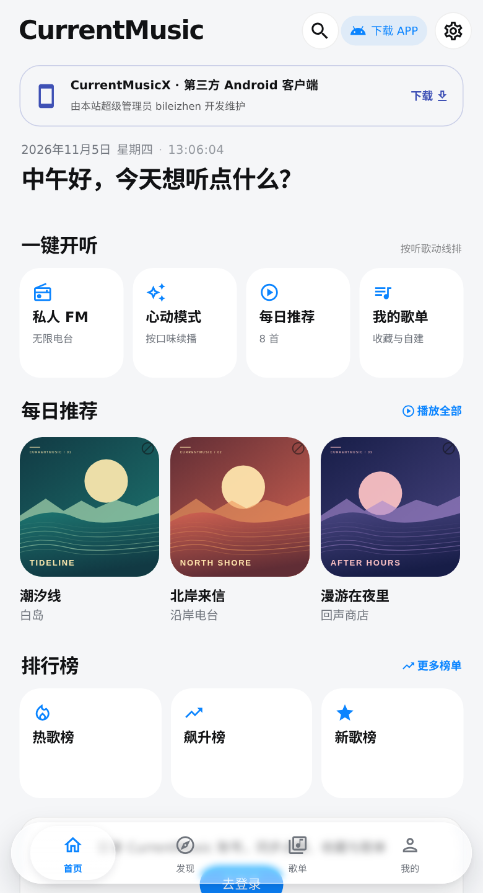
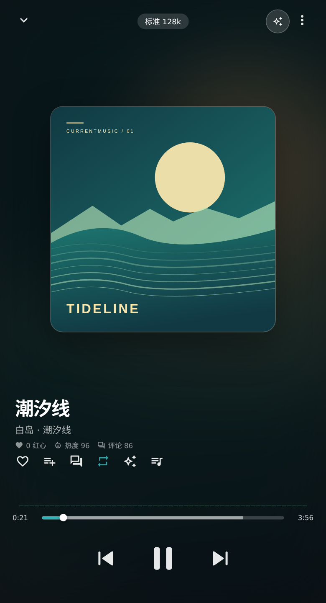
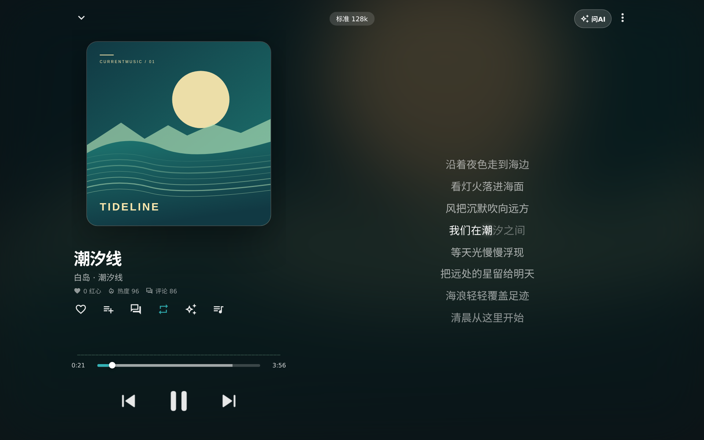
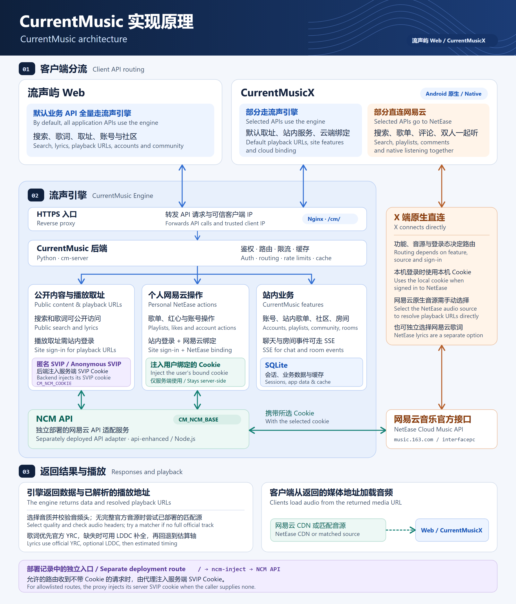

<div align="center">


# CurrentMusic

[简体中文](README.md) · **English**

**Listen in your browser or host your own music service.**

Word-by-word lyrics · Cloud playlists · Listening rooms

<p>
  <a href="CHANGELOG.md"></a>
  <a href="https://github.com/backrooms-yrc/CurrentMusic/actions/workflows/ci.yml"></a>
  <a href="LICENSE"></a>
</p>

**[Open CurrentMusic Web](https://music.20110208.xyz/app/)** · **[CurrentMusicX community client](https://github.com/bileizhen/CurrentMusicX)** · **[CurrentMusic Engine](https://music.20110208.xyz/home/engine/)**

[Screenshots](#screenshots) · [Features](#features) · [Architecture](#architecture) · [Self-hosting and builds](#self-hosting-and-builds) · [API docs](https://music.20110208.xyz/api-docs/)

</div>

## Screenshots

<p align="center">
  <a href="docs/screenshots/readme-web-home.png"></a>
  <a href="docs/screenshots/readme-web-player.png"></a>
</p>

<p align="center"><sub>Current Web interface with a demo library. Click an image for the full size.</sub></p>

<details>
<summary>Desktop player</summary>

<p align="center">
  <a href="docs/screenshots/readme-web-desktop.png"></a>
</p>

</details>

## Getting started

- **Web player.** Open it directly in a browser. Sign in to CurrentMusic to play tracks and sync likes, favorites, playlists, and search history. Link NetEase to access its playlists and recommendations.
- **CurrentMusicX.** This community-maintained native Android client has its own [installation, compatibility, and feature documentation](https://github.com/bileizhen/CurrentMusicX).

## Features

| Area | What you can do |
| --- | --- |
| **Discovery** | Search by category or lyrics, browse daily recommendations and charts, and use Personal FM and Heartbeat mode. |
| **Playback and lyrics** | Select audio quality, use automatic source fallback, see word-by-word lyrics and translations, view quality details, jump to a chorus, and find other track versions. |
| **Library** | Manage CurrentMusic playlists, likes, favorites, recent plays, and listening stats. Link a NetEase account for its library. |
| **Listening rooms and sharing** | Play in sync with a room, manage its queue, and generate track links and square or immersive share images. |
| **Appearance and interaction** | Use light or dark themes, artwork colors, glass effects, and a mini player across phone, tablet, and desktop layouts. Select Aimo under **Settings → Appearance → Interface style**. |
| **Accounts and community** | Use passkeys, two-factor verification, community posts, public chat, and the optional AI assistant. |

## Architecture

[](docs/images/architecture.png)

### How the clients route requests

- **CurrentMusic Web** sends application API requests for search, track details, lyrics, playback URLs, accounts, and community features to the engine at `/cm/` by default. Selecting LeiZ sends playback URL requests directly to LeiZ. The cloud upload flow obtains a token and registers the file through the engine, while the browser can send the file itself directly to object storage.
- **CurrentMusicX** routes each request by feature, audio source, and sign-in state. Playback URL resolution with the default source, CurrentMusic accounts and playlists, the community, CurrentMusic rooms, and cloud account linking go through the engine. Search, comments, and NetEase's native two-person listening can go directly to NetEase. With a local NetEase session, personal playlists, likes, and recommendations generally go directly as well. With no local session, selected account features can use the engine's saved NetEase binding. Selecting the native NetEase audio source makes the phone resolve playback URLs directly. Lyrics have their own source setting.

### How the engine handles requests

1. An HTTPS reverse proxy forwards `/cm/` to the Python backend and supplies a trusted client IP. The backend applies route-specific authentication, rate limits, and caching. Guests can request public search results, track details, and lyrics. Media URL resolution requires a CurrentMusic account. Search and playback URL requests can pass the trusted IP upstream and partition the cache by IP.
2. The backend handles CurrentMusic accounts, playlists, community features, and rooms. SQLite stores sessions and application data. Chat and listening rooms can receive updates over Server-Sent Events (SSE). For NetEase operations, the backend calls the separately deployed NCM API at `CM_NCM_BASE`. This Node.js service (api-enhanced) makes the NetEase protocol request and returns the result.
3. Personal NetEase actions use a separate authentication path. The engine checks the CurrentMusic session and retrieves that user's linked NetEase cookie to access playlists, likes, and other account data. After local NetEase sign-in, X can sync the credential through `/cm/ncmbind/import`, where the server verifies the account before storing it. The engine uses its stored cookies server-side.

### How Anonymous SVIP resolves a playback URL

1. A signed-in **CurrentMusic** user sends their site token, track ID, and requested quality to `GET /cm/ncm/song/url`. “Anonymous” refers to playback URL resolution without a personal NetEase account binding.
2. The backend reads the server's NetEase SVIP cookie from the file configured by `CM_NCM_COOKIE` and injects it into the official `/song/url/v1` request to the NCM API. NetEase responds according to the server account's entitlements, track restrictions, and requested quality. The site token authenticates the user to the engine. The server cookie authenticates the upstream request.
3. The engine selects an available quality and probes the audio header at the resulting official URL. If official resolution fails or yields a preview, a deployed matcher can look up alternate sources and validate the audio and duration. The matcher uses public track metadata and receives neither NetEase cookie.
4. The backend returns the playback URL and verifiable audio properties. For normal playback, Web and X read the audio directly from the returned CDN or matched-source URL. Lyrics have a separate endpoint. The engine prefers official YRC, can use LDDC for missing word timings, and falls back to LRC with estimated timings marked. X can independently select direct NetEase lyrics or automatic matching across sources.

The deployment notes also describe a separate `ncm-inject` entry point. It adds the server SVIP cookie to allowlisted requests that arrive without a caller cookie, then passes them to the NCM API. The default client routes in the diagram use `/cm/`.

[Backend](backend/README.md) · [Playback URL resolution](docs/playback-sources.md) · [Account linking](docs/third-party-ncm-sync.md) · [Lyrics API](docs/lyrics-api.md) · [Deployment notes](docs/api-5-phase-plan.md#1-实测拓扑)

## Self-hosting and builds

### Start the backend

Use Python 3.11 or later and run these commands from the repository root.

```bash
python3 -m venv .venv
. .venv/bin/activate
python3 -m pip install -r deploy/requirements-auth.txt -r deploy/requirements-search.txt
mkdir -p data
cp deploy/backend.env.example data/backend.env
# Set CM_DATA_DIR, CM_DB, and other paths in data/backend.env to absolute paths for this instance.
set -a
. data/backend.env
set +a
python3 backend/manage.py init-db
python3 backend/manage.py create-owner admin --nickname admin
python3 backend/cm_server.py
```

The backend listens at `127.0.0.1:3010` by default. Check it with `GET /health`. When you omit the owner password, the setup command generates one and displays it once.

Music features use a separate NetEase API at `CM_NCM_BASE`. CurrentMusic accounts and playlists can run independently. Configure AI, email, SMS, share images, and LDDC as needed. See the backend and deployment guides for production setup and reverse proxy configuration. [Backend guide](backend/README.md) · [Deployment templates](deploy/README.md)

### Build the Web app

Use Node.js 20 or later from the repository root.

```bash
npm --prefix web ci
python3 tools/check-js-refs.py
npm --prefix web run build
python3 tools/deploy-web.py --target data/app
```

The Web build writes to `app/src/main/assets/www/`. The deployment script syncs static assets first, then switches the index to the content-fingerprinted build.

<details>
<summary>Build the Android shell, website, and API docs</summary>

The Android shell requires JDK 17, Android SDK Platform 34, and Build Tools 34.0.0. It supports Android 7.0 (API 24) and later.

```bash
export ANDROID_HOME=/path/to/android-sdk
bash build.sh
```

The APK goes to `dist/`. The version defaults to `web/src/version.js` and can be overridden with `VER_NAME` and `VER_CODE`. The first local build creates a self-signed keystore. Use the same signature for upgrades. Configure the signing password with `CM_KS_PASS` and keep the keystore and password local.

```bash
# The website reuses Web dependencies and writes to data/www.
node site/build.mjs

npm --prefix api-docs ci
npm --prefix api-docs run build
npm --prefix api-docs run publish
```

The API docs build from backend routes and the registry. Set `NCM_API_DIR` to the separate api-enhanced source directory to include upstream parameter excerpts. [API docs build guide](api-docs/README.md)

</details>

<details>
<summary>Repository layout</summary>

| Directory | Contents |
| --- | --- |
| `backend/` | Python backend, accounts, NetEase gateway, playback, rooms, CurrentStation Passport, and AI |
| `web/` | Shared Web and Android interface |
| `app/` | Java WebView shell and frontend assets |
| `windows/` | C# and WinUI 3 native client and installer source |
| `site/`, `api-docs/` | Project website and API reference |
| `deploy/` | systemd, Nginx, environment, and backup templates |
| `tools/`, `docs/` | Build, validation, and maintenance scripts and API documentation |

</details>

## Contributing

Open an issue or submit a pull request. Run build and regression checks that cover your change. Backend tests use a temporary database and data directory. [Report an issue](https://github.com/backrooms-yrc/CurrentMusic/issues) · [Contribution guide](CONTRIBUTING.md) · [Changelog](CHANGELOG.md)

<details>
<summary>Common validation commands</summary>

```bash
tools/run-tests.sh
python3 tools/test-api-docs.py
python3 tools/test-open-source.py
python3 tools/check-open-source.py
```

</details>

This repository preserves the commits, tags, and releases of the original public frontend repository. The backend and other components were added as reviewed source snapshots. Runtime data and service credentials stay in the deployment environment. [Public source boundary and migration](docs/open-source-checklist.md) · [Security reporting](SECURITY.md) · [RealIP handling](docs/realip.md)

## License and credits

The project's own code uses the MIT license. Upstream documentation, dependencies, fonts, and independent services retain their respective licenses. LDDC runs as a separate service. Music, cover artwork, and user avatars follow their respective licenses. [MIT license](LICENSE) · [Third-party notices](THIRD_PARTY_NOTICES.md)
