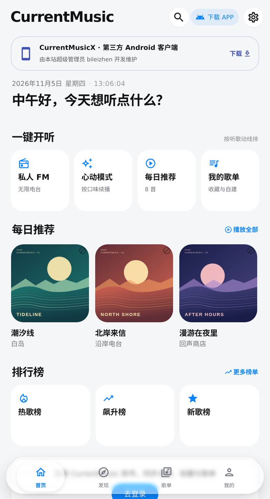
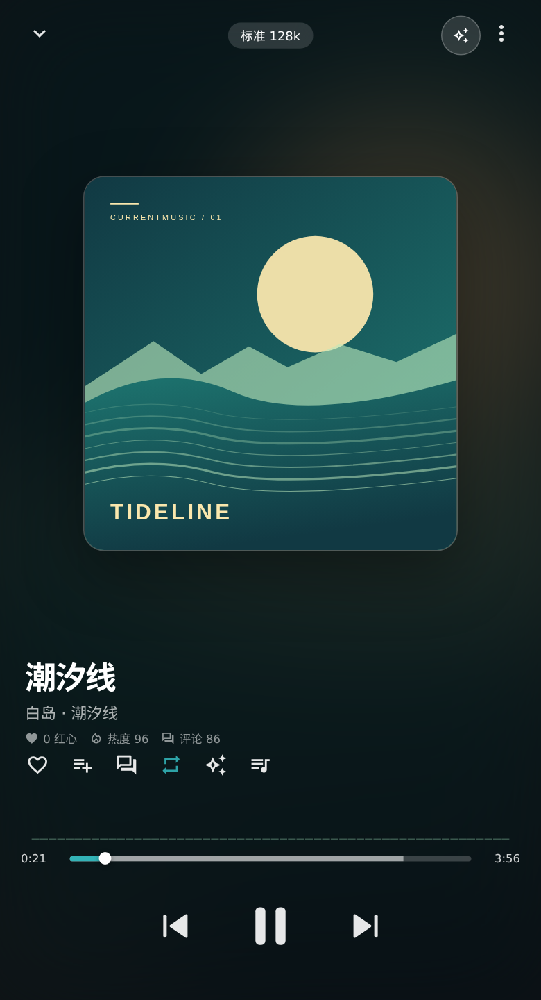
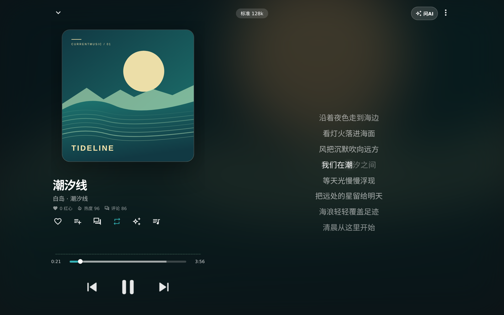

<div align="center">


# CurrentMusic

**用浏览器听歌，也可以搭建自己的音乐服务。**

逐字歌词 · 云端歌单 · 多人一起听

<p>
  <a href="CHANGELOG.md"></a>
  <a href="https://github.com/backrooms-yrc/CurrentMusic/actions/workflows/ci.yml"></a>
  <a href="LICENSE"></a>
</p>

**[打开 CurrentMusic 流声屿](https://music.20110208.xyz/app/)** · **[社区客户端 CurrentMusicX](https://github.com/bileizhen/CurrentMusicX)** · **[流声引擎官网](https://music.20110208.xyz/home/engine/)**

[界面预览](#界面预览) · [功能一览](#功能一览) · [自托管与构建](#自托管与构建) · [API 文档](https://music.20110208.xyz/api-docs/)

</div>

## 界面预览

<p align="center">
  <a href="docs/screenshots/readme-web-home.png"></a>
  <a href="docs/screenshots/readme-web-player.png"></a>
</p>

<p align="center"><sub>当前 Web 界面 · 演示曲库 · 点击图片查看原图</sub></p>

<details>
<summary>查看桌面播放页</summary>

<p align="center">
  <a href="docs/screenshots/readme-web-desktop.png"></a>
</p>

</details>

## 开始使用

- **Web 播放器**可直接在浏览器打开。登录 CurrentMusic 后，可以播放歌曲并同步红心、收藏、歌单和搜索历史。按需绑定网易云账号，即可使用对应的歌单和推荐。
- **CurrentMusicX** 是社区维护的原生 Android 客户端。安装、兼容性和功能说明见其仓库。

## 功能一览

| 功能 | 支持能力 |
| --- | --- |
| **发现音乐** | 分类搜索、按歌词搜歌、每日推荐、排行榜、私人漫游与心动模式。 |
| **播放与歌词** | 音质选择、自动音源回退、逐字歌词与翻译、音质资料、副歌跳转及版本推荐。 |
| **整理曲库** | 自建歌单、红心、收藏、最近播放和听歌统计，支持绑定网易云。 |
| **一起听与分享** | 房间内同步播放和管理队列，生成歌曲链接、方块或沉浸式分享图。 |
| **外观与交互** | 深浅主题、封面取色、玻璃效果、迷你播放器，以及手机和平板、桌面的响应式布局。 |
| **账号与交流** | 通行密钥、两步验证、社区动态、聊天室和可选 AI 助手。 |

## 自托管与构建

### 启动后端

在仓库根目录执行以下命令。后端需要 Python 3.11+。

```bash
python3 -m venv .venv
. .venv/bin/activate
python3 -m pip install -r deploy/requirements-auth.txt -r deploy/requirements-search.txt
mkdir -p data
cp deploy/backend.env.example data/backend.env
# 编辑 data/backend.env，将 CM_DATA_DIR、CM_DB 等路径设为当前实例的绝对路径。
set -a
. data/backend.env
set +a
python3 backend/manage.py init-db
python3 backend/manage.py create-owner admin --nickname 管理员
python3 backend/cm_server.py
```

后端默认监听 `127.0.0.1:3010`，可用 `GET /health` 检查状态。创建站长时省略密码会生成随机密码并显示一次。

音乐功能通过 `CM_NCM_BASE` 连接独立部署的网易云 API。账号、歌单等本地功能可单独运行，AI、邮件、短信、分享图和 LDDC 按需配置。生产部署和反向代理见 [后端说明](backend/README.md) 与 [部署模板](deploy/README.md)。

### 构建 Web

使用 Node.js 20+ 在仓库根目录构建。

```bash
npm --prefix web ci
python3 tools/check-js-refs.py
npm --prefix web run build
python3 tools/deploy-web.py --target data/app
```

前端产物写入 `app/src/main/assets/www/`。部署脚本会先同步静态资源，再切换带内容指纹的首页。

<details>
<summary>Android 壳、官网与文档站构建</summary>

Android 构建需要 JDK 17、Android SDK Platform 34 和 Build Tools 34.0.0，最低支持 Android 7.0（API 24）。

```bash
export ANDROID_HOME=/path/to/android-sdk
bash build.sh
```

APK 写入 `dist/`。版本默认取自 `web/src/version.js`，也可通过 `VER_NAME` 和 `VER_CODE` 设置。首次本地构建会创建自签名密钥，升级时需使用相同签名。签名密码通过 `CM_KS_PASS` 配置，密钥和密码保存在本机。

```bash
# 官网复用 Web 依赖，输出到 data/www。
node site/build.mjs

npm --prefix api-docs ci
npm --prefix api-docs run build
npm --prefix api-docs run publish
```

文档从当前后端路由和登记表生成。构建时可用 `NCM_API_DIR` 指定独立的 api-enhanced 源码目录，加入上游接口参数摘录。详见 [文档构建说明](api-docs/README.md)。

</details>

<details>
<summary>仓库目录</summary>

| 目录 | 内容 |
| --- | --- |
| `backend/` | Python 后端、账号、网易云网关、播放、房间、通行证与 AI |
| `web/` | Web 与 Android 共用界面 |
| `app/` | Java WebView 壳及前端静态资源 |
| `windows/` | C# / WinUI 3 原生客户端及安装器源码 |
| `site/`、`api-docs/` | 官网与 API 文档站 |
| `deploy/` | systemd、Nginx、环境变量与备份模板 |
| `tools/`、`docs/` | 构建、验证、维护脚本与接口说明 |

</details>

## 参与贡献

欢迎通过 Issue 反馈问题或提交 PR。提交前按改动范围运行构建与回归检查。后端测试使用临时数据库和数据目录。 [反馈问题](https://github.com/backrooms-yrc/CurrentMusic/issues) · [贡献指南](CONTRIBUTING.md) · [更新日志](CHANGELOG.md)

<details>
<summary>常用验证命令</summary>

```bash
tools/run-tests.sh
python3 tools/test-api-docs.py
python3 tools/test-open-source.py
python3 tools/check-open-source.py
```

</details>

主仓库保留了原公开前端仓库的提交、标签与 Releases，后端及其他组件以审查后的源码快照加入。运行数据和服务凭据保留在部署环境。 [公开边界与迁移记录](docs/open-source-checklist.md) · [安全问题报告](SECURITY.md) · [RealIP 说明](docs/realip.md)

## 开源与致谢

项目自有代码采用 MIT。上游文档、依赖、字体和独立服务保留各自许可。LDDC 作为独立服务接入，音乐、封面、用户头像等内容遵循各自授权。 [MIT 许可](LICENSE) · [第三方声明](THIRD_PARTY_NOTICES.md)
