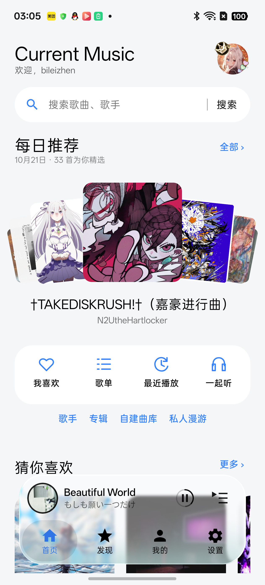
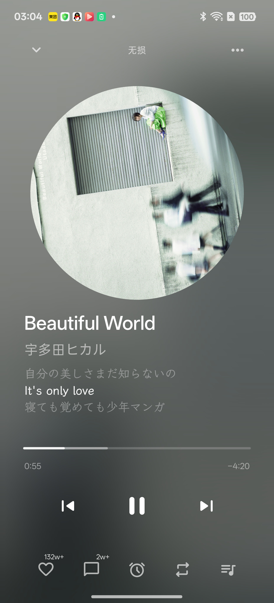
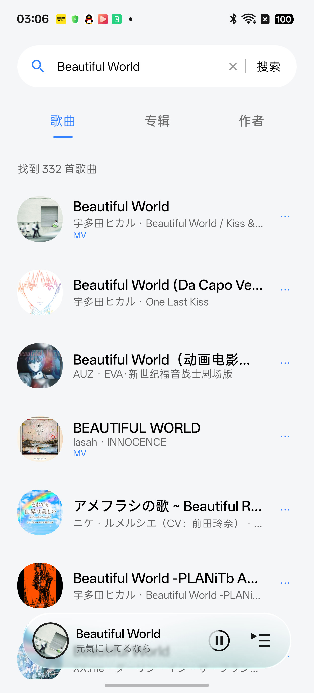
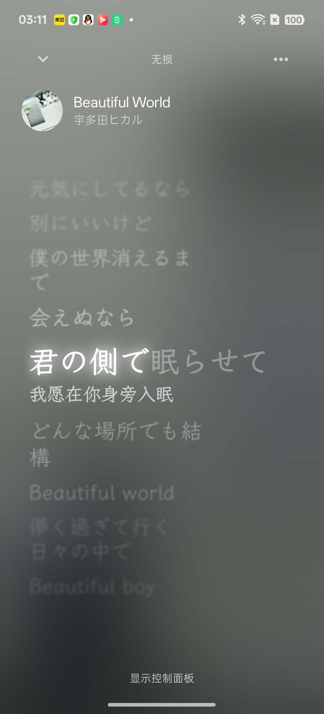
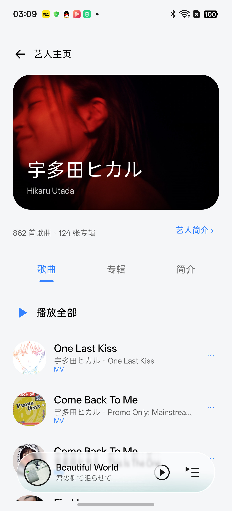
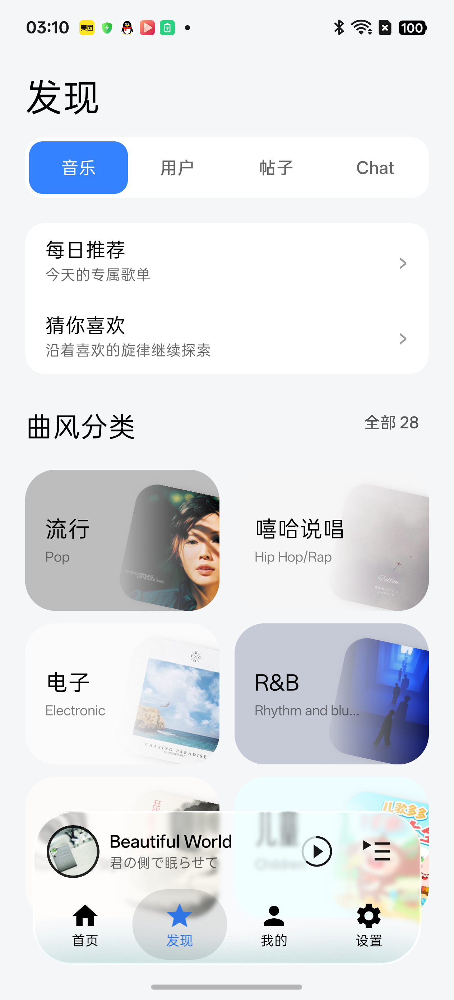

# CurrentMusicX

让封面、歌词与音乐一起流动

基于 Kotlin · Jetpack Compose · Miuix 的原生 Android 音乐客户端

  
  
  

**[下载应用](https://github.com/bileizhen/CurrentMusicX/releases/latest)** · [界面预览](#界面预览) · [更新记录](CHANGELOG.md) · [反馈问题](https://github.com/bileizhen/CurrentMusicX/issues)

## 简介

CurrentMusicX 是 [CurrentMusic](https://github.com/backrooms-yrc/CurrentMusic) 的原生 Android 客户端，支持网易云音乐库、Navidrome 自建曲库和双人一起听。圆形封面、动态取色、逐字歌词与悬浮播放器组成日常听歌体验，适配竖屏、横屏和宽屏布局。

本页介绍当前源码的功能；已发布版本的具体改动请查看[更新记录](CHANGELOG.md)。源码位于本仓库 `main` 分支，同时维护于 [CurrentMusic 的 app 分支](https://github.com/backrooms-yrc/CurrentMusic/tree/app)。

## 开始使用

1. 前往 **[Releases](https://github.com/bileizhen/CurrentMusicX/releases/latest)** 下载 `CurrentMusic-Android-v版本号.apk`，按系统提示安装。同签名正式版可覆盖升级。
2. 在「设置 → 网络与播放」选择音乐音源和歌词来源。两项独立设置，**歌词默认使用 CurrentMusic**。
3. 按需登录 CurrentMusic、绑定网易云，或在「我的 → 自建曲库」连接 Navidrome，即可搜索、收藏和播放。

歌曲、音质、会员音效及推荐的可用性，以对应服务和账号权限为准。

## 界面预览

首页 · 播放器 · 搜索（RMX5060 真机截图，2026-10-21）

查看更多界面

歌词 · 艺人主页 · 发现（界面以实际安装版本为准）

## 功能一览

| 功能 | 支持内容 |
| --- | --- |
| **播放与控制** | 后台、通知栏、锁屏与蓝牙控制；队列、循环、随机、心动模式；定时关闭、DLNA 投屏、MV 播放与下载 |
| **歌词与动效** | LRC / YRC / TTML、逐字高亮、翻译与罗马音；莫奈歌词动画、流烟、星尘及透视效果；字体、字号与偏移调整 |
| **音乐库** | 网易云我喜欢与歌单管理、CurrentMusic 自建歌单；Navidrome 专辑、艺术家、收藏、搜索和原音质播放 |
| **私人漫游** | 默认、熟悉、探索、拼图及动态场景；原播放器内切换模式、连续推荐，结束后可恢复原队列 |
| **双人一起听** | 网易云原生邀请与短链接、共享队列、同步切歌、断线恢复；一起听记录、排行、结束报告与缘分报告 |
| **网易云任务** | 原生任务中心、云贝与会员成长值、音乐人任务；每日签到、已完成奖励领取、前台自动签到与本机记录，默认关闭 |
| **发现与交流** | 搜索候选词建议，歌曲、歌词、专辑、作者和歌单分类搜索；每日推荐、热搜、音乐风格；用户、帖子、公共聊天与 AI 对话；播放页私有「问 AI」 |
| **音效与过渡** | 本机均衡器、原版标准及智能音效、AI 情绪调音师、AI 调音大师与外放场景；智能过渡或淡入淡出 |
| **下载与分享** | 音质与目录选择、后台进度、取消及重试；音频标签、封面与歌词写入；封面取色海报、播放链接与二维码 |
| **外观与桌面** | 深浅主题、Monet 取色、经典或光环开屏、可选模糊与玻璃效果；自定义播放背景与模糊度；悬浮底栏、桌面歌词灵动岛、双人头像与头像挂件 |
| **账号与更新** | 多账号、个人资料、听歌统计、全部公告；正式版 / 预发布更新渠道，后台下载及安装包校验 |

播放、歌词与音效说明

- 搜索结果点击单曲只插入并播放该曲，保留原队列；歌单和专辑支持整列表播放。
- 自动切歌的智能过渡与淡入淡出择一开启，默认关闭；淡入淡出可调 1–12 秒。允许与其他应用同时播放可单独设置。
- 「设置 → 外观 → 开屏动画」可切换经典与光环样式，并直接预览；经典为默认，光环开屏显示当前用户名。
- 「播放器右上角菜单 → 播放背景」可从系统选择图片，预览并调整 0–100% 模糊度；图片仅保存在本机，重启保留，可恢复默认封面取色背景。
- 「我的 → 网易云账号 → 网易云任务」开启后，“我的”页会在网易云账号下方显示任务入口。需要本机网易云登录；自动签到另行开启，仅在 App 前台进行日常与云贝签到。任务进度和奖励由网易云确认，听歌使用实际播放记录。
- 歌词优先使用真实逐字时间，过滤服务端估算轴。卡拉 OK 兼容策略选「总是」时，可为普通逐行歌词生成近似高亮，属于本地显示效果。
- 音效页面使用原生 Compose；已内置适配的 ARM64 引擎，无需另装网易云。会员权益由服务端核验，未接入的算法会明确提示；外放场景仅在当前运行期间保留。
- 应用内不常驻显示歌词 / FPS 灵动岛，仅临时显示音效、下载与错误反馈；桌面悬浮歌词需系统授权，支持位置、字号、翻译和锁定。详见[桌面歌词说明](DESKTOP_LYRICS.md)。

音乐库与一起听说明

- 网易云登录需先注册并登录 CurrentMusic 账号，再使用扫码或手机验证码。本机登录后仍直连网易云搜索、歌单、收藏、推荐与评论。没有本机登录时，部分服务可复用 CurrentMusic 账号的云端绑定，云端凭据不下载到本机。
- 「网易云作为主音乐库」决定默认音乐库入口；「设置 → 网络与播放 → 默认红心位置」独立控制收藏目标。Navidrome 歌曲使用自己的服务器收藏。
- 歌单支持搜索、排序、创建与管理，可选 Depth Ribbon 立体缎带或 CD 唱片架浏览；唱片架支持搜索收拢、随机挑歌、高潮片段或整首试听、循环与自动下一首，取消喜欢后可在灵动岛撤销。CurrentMusic 自建歌单可导入网易云「我喜欢」。切换音乐库不会删除原有歌单。
- 搜索首页支持收起历史、双列推荐词和可横滑的网易云搜索热榜（含 ACG、日语等分类）；输入片段显示候选词，点选直接搜索；「歌词」分类支持输入记得的歌词搜歌，并展示命中的歌词片段。
- 搜索页「歌单」分类展示网易云歌单封面、创建者和歌曲数，支持分页与失败重试；点击沿用原有歌单详情，切换分类及返回后保留结果与滚动位置。
- 网易云一起听复用原有搜索与播放队列，支持双方口味推荐、移除、清空、整队列下载和收藏；推荐、历史、排行与报告受服务端权限限制。
- 冷启动检查并恢复中断的网易云会话；启动时主动开始其他播放会取消本次自动恢复。结束会话后，确认远端结束才展示报告，可收藏歌曲并导出分享海报。
- CurrentMusic 服务器房间另支持密码、点歌审批和成员权限。Navidrome 私有曲库当前仅在本机播放，不参与 CurrentMusic 房间或 DLNA 投屏。

## 音源与歌词

在「设置 → 网络与播放」分别调整，切换歌词来源会重新加载当前歌词，缓存按来源隔离。

| 设置 | 选项 | 请求方式 |
| --- | --- | --- |
| 音乐音源 | **CurrentMusic（默认）** | 通过配置的 CurrentMusic 服务器取流，需站内账号 |
| 音乐音源 | 网易云原生 | 手机直连网易云获取歌曲与 MV，使用本机网易云账号权限，不自动回退到服务器取流 |
| 音乐音源 | LeiZ API | 使用对应音源服务 |
| 歌词来源 | **CurrentMusic 歌词（默认）** | 使用服务器歌词，含其提供的 LDDC 真实逐字数据 |
| 歌词来源 | 网易云歌词 | 手机直连网易云 YRC / LRC；没有真实逐字数据时显示逐行歌词 |

**希望歌曲和歌词都直连网易云时，请同时选择「网易云原生」音源和「网易云歌词」。** 仅切换音乐音源不会改变歌词来源。本机网易云音乐库与原生双人一起听也独立直连网易云。

CurrentMusic 默认服务器为 `https://music.20110208.xyz/cm/`，可在设置中修改；它用于站内账号、CurrentMusic 音源与歌词、云端绑定、个人资料、社区及服务器房间。Navidrome 音频直接从自己的服务器播放。

## 兼容性

| 项目 | 要求 |
| --- | --- |
| 系统 | Android 8.0 / API 26 及以上；目标 Android 16 / API 36 |
| 架构 | 正式安装包面向 ARM64（arm64-v8a），包含适配的原版音效引擎 |
| 布局 | 竖屏、横屏与宽屏导航 |
| 动态颜色 | Monet 需要 Android 12 / API 31 及以上 |
| 实时模糊 | Android 13 / API 33 及以上；低版本或关闭时使用普通材质 |
| 下载目录 | 系统文件夹选择器 / SAF；Android 10 及以上默认 `Download/CurrentMusic` |

## 常见问题

下载的歌曲、封面和歌词保存在哪里？

下载时可指定目录，并授予该目录访问权限。歌曲信息、封面与歌词写入音频文件，同时保存配套 LRC 和封面。支持 MP3、FLAC、M4A、Vorbis OGG、WAV，裸 AAC 无损封装为 M4A。其他播放器的内嵌歌词与逐字显示能力取决于格式及其自身支持。

如何更新？自行构建的包能覆盖官方版吗？

在「设置 → 检查更新」查看新版本，可调整启动检查、更新渠道和下载来源。启动发现新版本时可先忽略或查看详情；来源列表显示状态与延迟，专用镜像置顶，其余可用来源按延迟排序。后台下载支持取消、重试和换源；默认镜像失败或文件大小、SHA-256 不符时尝试备用源。校验包名与签名后，由 Android 系统确认安装；首次可能需要允许安装未知来源应用。

自行构建的包若与官方签名不同，无法直接覆盖。开发与设备测试请使用[独立测试包](BUILDING.md#设备测试)，与日常安装分开。

如何反馈问题？

请在 [Issues](https://github.com/bileizhen/CurrentMusicX/issues) 提供应用版本、手机型号、Android 版本、复现步骤与现象。可从设置中导出诊断日志，分享前检查并遮挡个人信息。

## 隐私与开发

本机账号凭据加密保存，服务分别请求对应的网易云、CurrentMusic 或 Navidrome 接口；音频、MV 与图片从对应服务返回的地址加载。下载文件保存在用户选择的目录。数据用途及保存方式见[隐私说明](PRIVACY.md)。

- [从源码构建与设备测试](BUILDING.md)
- [桌面歌词说明](DESKTOP_LYRICS.md)
- [更新记录](CHANGELOG.md)
- [第三方依赖与许可证](THIRD_PARTY_NOTICES.md)

欢迎提交 Issue 或 Pull Request。请说明解决的问题、实际验证结果，并按独立功能或修复拆分提交。

## 开源与致谢

既有代码按 [GPL-3.0-only](LICENSE) 分发；Folia 莫奈歌词动画与播放暂停渐变移植组件按 [AGPL-3.0-only](app/src/main/assets/legal/AGPL-3.0.txt) 分发，组合遵循两份许可证第 13 节。各上游组件保留自己的版权与许可，完整说明见[第三方声明](THIRD_PARTY_NOTICES.md)。

感谢 [CurrentMusic](https://github.com/backrooms-yrc/CurrentMusic)、[Folia](https://github.com/chthollyphile/folia-major)、[Miuix](https://github.com/compose-miuix-ui/miuix)、[SukiSU-Ultra](https://github.com/SukiSU-Ultra/SukiSU-Ultra)、[AndroidLiquidGlass](https://github.com/Kyant0/AndroidLiquidGlass)、[LeiFetch](https://github.com/bileizhen/LeiFetch)、[123PanX](https://github.com/bileizhen/123PanX)、[XBlocker](https://github.com/bileizhen/XBlocker)、[AMLL TTML DB](https://github.com/amll-dev/amll-ttml-db)、[LXGW WenKai](https://github.com/lxgw/LxgwWenKai)，以及 AndroidX、Media3、Coil、Jaudiotagger、ZXing 等开源项目。

## 浏览量

